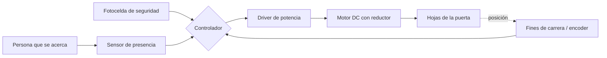

# Sensores y actuadores en sistemas mecatrónicos
---

## 1. Conceptos básicos

### ¿Qué es un sensor?
Es un dispositivo que percibe una magnitud física o química del entorno (temperatura, luz, posición, presión, etc.) y la convierte en una señal, normalmente eléctrica, que un controlador puede leer e interpretar.

### ¿Qué es un actuador?
Es un dispositivo que recibe una señal de control y la transforma en una acción física: movimiento, fuerza, giro, calor, etc. Toma energía (eléctrica, neumática o hidráulica) y la convierte en trabajo mecánico.

### ¿Cuál es la diferencia entre un sensor y un actuador?
Van en direcciones opuestas dentro del flujo de información:

| | Sensor | Actuador |
|---|---|---|
| Función | Observa y mide | Ejecuta una acción |
| Dirección | Mundo físico → controlador | Controlador → mundo físico |
| Energía | Entrega una señal pequeña de información | Maneja potencia para producir trabajo |
| Ejemplo | Termistor | Motor eléctrico |

### ¿Qué función tienen dentro de un sistema mecatrónico?
Los sensores son los "sentidos" del sistema: le dicen qué está pasando. Los actuadores son los "músculos": ejecutan las decisiones. Entre ambos está el controlador (microcontrolador, PLC, etc.), que interpreta las señales de los sensores y decide qué ordenar a los actuadores. Juntos forman un lazo de control.

### Ejemplo sencillo: aire acondicionado
- **Sensor:** un sensor de temperatura detecta la temperatura del aire de la habitación.
- **Controlador:** compara esa temperatura con la que el usuario configuró.
- **Actuador:** si la habitación está más caliente de lo deseado, el controlador enciende el compresor y el ventilador (motores eléctricos), que enfrían el aire hasta alcanzar la temperatura objetivo.

---

## 2. Investigación de sensores

| Tipo de sensor | Variable que mide | Principio de funcionamiento | Señal que entrega | Ejemplo | Aplicación |
|---|---|---|---|---|---|
| **Temperatura** | Temperatura (°C) | Algunos materiales cambian una propiedad eléctrica con la temperatura: un termistor cambia su resistencia, un termopar genera un pequeño voltaje por la unión de dos metales distintos. | Analógica (voltaje o resistencia); digital en modelos con convertidor integrado | LM35 (Texas Instruments), DS18B20 (digital) | Control de temperatura en hornos y aires acondicionados |
| **Luz** | Intensidad luminosa | Una fotorresistencia (LDR) disminuye su resistencia al recibir más luz; un fotodiodo genera corriente proporcional a la luz que lo golpea. | Analógica; digital en modelos como el BH1750 | LDR GL5528, BH1750 | Encendido automático de alumbrado público |
| **Proximidad** | Presencia de un objeto cercano, sin contacto | Inductivo: detecta metales por cambios en un campo electromagnético. Capacitivo: detecta cambios en la capacitancia. Óptico: detecta la reflexión de luz infrarroja. | Digital (ON/OFF); algunos entregan señal analógica | Sensor inductivo Omron E2E | Detección de piezas metálicas en una banda transportadora |
| **Distancia** | Distancia a un objeto (cm, m) | Ultrasónico: emite sonido y mide el tiempo de regreso del eco. Infrarrojo: usa triangulación de un haz de luz. Láser (ToF): mide el tiempo de vuelo de la luz. | Digital (pulso con duración proporcional) o analógica | HC-SR04 (ultrasónico), Sharp GP2Y0A21 (infrarrojo) | Evasión de obstáculos en robots móviles |
| **Presión** | Presión de un gas o líquido (Pa, bar, psi) | Un diafragma se deforma con la presión y galgas extensométricas (piezorresistivas) convierten esa deformación en cambio de resistencia. | Analógica (voltaje o 4–20 mA); digital con interfaz I2C/SPI | BMP280 (Bosch), transductores Honeywell | Monitoreo de presión de neumáticos o de líneas neumáticas |
| **Humedad** | Humedad relativa del aire (%) | Un material higroscópico (polímero) absorbe humedad y cambia su capacitancia o resistencia. | Analógica o digital | DHT22, SHT31 (Sensirion) | Control de humedad en invernaderos |
| **Posición** | Posición lineal o angular | Potenciómetro: la resistencia varía con la posición del cursor. Encoder: genera pulsos al girar un disco con ranuras. LVDT: la posición de un núcleo modifica la inducción en bobinas. | Analógica (potenciómetro, LVDT) o digital (encoder) | Encoder óptico incremental, potenciómetro lineal | Medir el ángulo de las articulaciones de un brazo robótico |
| **Velocidad / movimiento** | Velocidad de giro, aceleración o movimiento | Encoder: se cuentan pulsos por unidad de tiempo. Acelerómetro MEMS: una masa microscópica se desplaza y varía la capacitancia. PIR: detecta cambios de radiación infrarroja de cuerpos en movimiento. | Digital (pulsos o I2C) o analógica | MPU6050 (acelerómetro/giroscopio), PIR HC-SR501 | Control de velocidad de motores; detección de movimiento en alarmas |
| **Fuerza / peso** | Fuerza o masa (N, kg) | Una celda de carga tiene galgas extensométricas pegadas a una pieza metálica; al deformarse por la carga, cambia su resistencia, y un puente de Wheatstone lo convierte en voltaje. | Analógica (mV, muy pequeña; requiere amplificador como el HX711) | Celda de carga tipo barra de 5 kg + HX711 | Básculas industriales y control de peso en líneas de empaque |

---

## 3. Clasificación de sensores

### Sensores analógicos y digitales
- **Analógico:** su señal de salida puede tomar *cualquier valor dentro de un rango continuo* y es proporcional a la variable medida. Un LM35 entrega 10 mV por cada °C, por lo que a 25 °C da 250 mV.
- **Digital:** su salida es una señal discreta, ya sea un nivel alto/bajo (ON/OFF) o datos codificados mediante un protocolo (I2C, SPI, 1-Wire). Un DS18B20 envía la temperatura como un número ya convertido.
- **Característica que los separa:** la *naturaleza de la señal de salida* (continua vs. discreta). Un analógico requiere un convertidor ADC para ser leído por un microcontrolador; un digital ya entrega datos listos para usarse.

### Sensores de contacto y sin contacto
- **De contacto:** necesitan tocar físicamente al objeto o medio que miden. Un termopar sumergido en un líquido o un interruptor de fin de carrera son ejemplos.
- **Sin contacto:** miden a distancia, sin tocar el objeto. Un sensor ultrasónico o un termómetro infrarrojo son ejemplos.
- **Característica que los separa:** *si existe interacción física directa* entre el sensor y el objeto medido. Los de contacto sufren desgaste, pero los sin contacto pueden verse afectados por el ambiente (polvo, luz, ruido).

### Sensores activos y pasivos
- **Activos:** requieren una fuente de energía externa para operar, ya sea para emitir una señal o para generar la salida. Un ultrasónico emite pulsos de sonido; una galga extensométrica necesita alimentación para producir un voltaje medible.
- **Pasivos:** generan su señal a partir de la propia energía del fenómeno medido, sin alimentación para excitarlos. Un termopar produce voltaje por sí mismo con el calor; un sensor PIR detecta el infrarrojo que ya emiten los cuerpos.
- **Característica que los separa:** *de dónde proviene la energía de la señal* (externa o del propio fenómeno). Cabe aclarar que muchos sensores pasivos igualmente necesitan alimentación para su electrónica de acondicionamiento, pero la señal en sí viene del fenómeno.

---

## 4. Investigación de actuadores

| Actuador | Energía utilizada | Movimiento | Cómo funciona | Ventaja | Limitación | Aplicación |
|---|---|---|---|---|---|---|
| **Motor DC** | Eléctrica | Rotatorio | La corriente pasa por bobinas dentro de un campo magnético y genera una fuerza que hace girar el rotor. | Control de velocidad sencillo y económico | Sin sensor adicional no controla posición exacta; las escobillas se desgastan | Ruedas de robots, ventiladores, juguetes |
| **Servomotor** | Eléctrica | Rotatorio con posición controlada (típicamente 0–180° en los de hobby) | Combina un motor DC, engranes y un sensor de posición (potenciómetro) con un circuito de control que corrige el error hasta alcanzar el ángulo pedido. | Posicionamiento preciso con retroalimentación integrada | Rango de giro limitado en los modelos básicos; torque pequeño en los económicos | Articulaciones de robots, timones de aeromodelismo |
| **Motor paso a paso** | Eléctrica | Rotatorio en pasos discretos | Activa en secuencia varias bobinas del estator y el rotor avanza un ángulo fijo por cada pulso (por ejemplo 1.8°). | Posición precisa en lazo abierto, sin necesidad de sensor | Puede perder pasos si se sobrecarga; consume corriente aun detenido | Impresoras 3D, máquinas CNC |
| **Solenoide** | Eléctrica | Lineal (corto recorrido) | Una bobina genera un campo magnético que jala un núcleo de hierro; un resorte lo regresa al desenergizar. | Respuesta muy rápida y diseño simple | Recorrido y fuerza limitados; solo dos posiciones (ON/OFF) | Cerraduras eléctricas, válvulas |
| **Cilindro neumático** | Neumática (aire comprimido) | Lineal | El aire comprimido empuja un pistón dentro del cilindro; una válvula dirige el aire a una u otra cámara para extender o retraer el vástago. | Rápido, limpio y de bajo costo | El aire es compresible, por lo que es difícil controlar posiciones intermedias; fuerza limitada | Empujar o sujetar piezas en líneas de producción |
| **Cilindro hidráulico** | Hidráulica (aceite a presión) | Lineal | Una bomba presuriza aceite que empuja el pistón; como el aceite es casi incompresible, la fuerza se transmite de forma firme. | Fuerza muy grande y movimiento estable | Requiere bomba, depósito y tuberías; riesgo de fugas, más pesado y costoso | Excavadoras, prensas industriales |

---

## 5. Comparación de actuadores

### Motor DC y servomotor
- **Diferencia:** el motor DC gira libremente según el voltaje aplicado, y no sabe en qué posición está. El servomotor incluye un sensor y un control que lo llevan a un ángulo específico y lo mantienen ahí.
- **Elige el motor DC** para mover la rueda de un robot móvil, porque necesito giro continuo y rápido, y no un ángulo exacto.
- **Elegiría el servomotor** para mover una articulación, porque necesito que la pieza llegue a un ángulo y se quede ahí.

### Servomotor vs. motor paso a paso
- **Diferencia:** ambos pueden posicionar con precisión, pero el servo usa retroalimentación (lazo cerrado) y el paso a paso avanza por pulsos contados (lazo abierto). El servo puede corregir errores; el paso a paso no sabe si perdió un paso.
- **Elegiría el motor paso a paso** en una impresora 3D, porque necesito muchas posiciones repetibles de manera sencilla y barata, con cargas conocidas y constantes.
- **Elegiría el servomotor** en un brazo que levanta cargas variables, porque si la carga cambia el servo compensa y evita perder la posición.

### Actuador neumático vs. hidráulico
- **Diferencia:** el neumático usa aire (compresible), es rápido, limpio y de fuerza moderada. El hidráulico usa aceite (casi incompresible), es más lento pero entrega fuerzas enormes con movimientos firmes.
- **Elegiría el neumático** para empujar cajas ligeras en una línea de empaque, porque es rápido, barato y una fuga de aire no ensucia el producto.
- **Elegiría el hidráulico** para una prensa o la pala de una excavadora, porque necesito una fuerza muy grande que el aire no podría entregar.

---

## 6. Sensores y actuadores en un sistema real

**Sistema elegido: puerta automática de un comercio.**

| Elemento | Tipo | Función |
|---|---|---|
| Sensor de movimiento por microondas o infrarrojo (presencia) | Sensor | Detecta que una persona se acerca a la puerta |
| Sensor de seguridad (fotocelda infrarroja) | Sensor | Detecta si hay una persona u objeto en el paso de la puerta mientras cierra, para evitar atrapamientos |
| Sensores de fin de carrera (o encoder) | Sensor | Indican si la puerta ya está completamente abierta o cerrada |
| Controlador (microcontrolador o PLC) | Procesamiento | Interpreta los sensores y decide cuándo abrir o cerrar |
| Motor DC con reductor y banda | Actuador | Desplaza físicamente las hojas de la puerta |

### Diagrama

**Funcionamiento:** el sensor de presencia detecta a una persona y lo informa al controlador. Este activa el motor mediante un driver de potencia y la puerta se abre hasta que el fin de carrera indica que llegó al final. Tras unos segundos sin detectar a nadie, se cierra; si la fotocelda de seguridad detecta algo en el paso, el controlador detiene el cierre y vuelve a abrir.

---

## 7. Selección de componentes

| Situación | Componente elegido | Razón |
|---|---|---|
| Detectar si una persona está frente a una puerta automática | **Sensor PIR o de microondas (radar)** | Detecta cuerpos en movimiento sin contacto y no requiere que la persona toque nada. El de microondas funciona mejor en puertas comerciales por su cobertura. |
| Medir la temperatura dentro de un salón | **Sensor LM35 o DS18B20** | Son económicos, tienen precisión suficiente (≈ ±0.5 °C) y son fáciles de conectar a un microcontrolador. |
| Detectar el nivel de agua de un depósito | **Sensor de nivel tipo flotador** (o ultrasónico para medición continua) | El flotador es robusto y barato para detectar niveles alto/bajo; el ultrasónico se prefiere si se necesita saber el nivel exacto sin tocar el agua. |
| Mover una rueda de un robot móvil | **Motor DC con reductor** | Da giro continuo y buen torque a baja velocidad, y es simple de controlar con PWM. |
| Controlar con precisión el ángulo de una pequeña articulación robótica | **Servomotor** | Tiene retroalimentación integrada, por lo que alcanza y mantiene un ángulo específico. |
| Empujar una pieza en una línea de producción | **Cilindro neumático** | Es rápido, económico y suficiente para empujar piezas de poco peso en ciclos repetitivos. |
| Medir la distancia entre un robot y una pared | **Sensor ultrasónico HC-SR04** (o infrarrojo/láser ToF si se requiere más precisión) | Mide sin contacto en el rango típico de un robot (2 cm a 4 m) a bajo costo. |
| Detectar si una habitación está iluminada | **Fotorresistencia (LDR)** o sensor BH1750 | La LDR es simple y económica para saber si hay luz o no; el BH1750 se elegiría si se necesita medir la intensidad en lux. |

---

## Reflexión final

**¿Qué diferencia encuentras entre medir una variable y realizar una acción física?**
Medir es obtener información: el sistema no cambia nada en el entorno, solo lo observa y lo convierte en una señal. Realizar una acción física implica modificar el entorno, y para eso se necesita energía y potencia. Un sensor maneja señales débiles (milivoltios o miliamperios), mientras que un actuador debe manejar corrientes, presiones o fuerzas mucho mayores. Esa diferencia se nota en el diseño: a los sensores hay que acondicionarles la señal, y a los actuadores hay que darles etapas de potencia como drivers o válvulas.

**¿Por qué un sistema mecatrónico normalmente necesita sensores y actuadores?**
Porque un sistema que solo actúa, sin medir, trabaja a ciegas: no sabe si la puerta ya abrió o si el motor llegó a la posición. Y un sistema que solo mide no puede hacer nada con esa información. La combinación de ambos permite el control en lazo cerrado: se mide, se compara con lo deseado, se corrige con el actuador y se vuelve a medir. Esto hace que el sistema sea más preciso, seguro y capaz de adaptarse a cambios del entorno.

**¿Qué sensor o actuador te pareció más interesante y por qué?**
El servomotor me pareció el más interesante porque en una sola pieza pequeña integra un motor, engranes, un sensor de posición y un circuito de control. Es básicamente un sistema mecatrónico completo en miniatura, y muestra de forma muy clara cómo un sensor y un actuador trabajan juntos en un lazo cerrado.

---

## Referencias

1. Bolton, W. (2018). *Mechatronics: Electronic Control Systems in Mechanical and Electrical Engineering* (6.ª ed.). Pearson.
2. Fraden, J. (2016). *Handbook of Modern Sensors: Physics, Designs, and Applications* (5.ª ed.). Springer.
3. Groover, M. P. (2020). *Automation, Production Systems, and Computer-Integrated Manufacturing* (5.ª ed.). Pearson.
4. Texas Instruments. (2017). *LM35 Precision Centigrade Temperature Sensors* [Hoja de datos]. https://www.ti.com/product/LM35
5. Maxim Integrated / Analog Devices. *DS18B20 Programmable Resolution 1-Wire Digital Thermometer* [Hoja de datos]. https://www.analog.com/en/products/ds18b20.html
6. Cytron Technologies. (2013). *HC-SR04 Ultrasonic Sensor* [Hoja de datos]. https://www.electroschematics.com/hc-sr04-datasheet/
7. Bosch Sensortec. *BMP280 Digital Pressure Sensor* [Hoja de datos]. https://www.bosch-sensortec.com/products/environmental-sensors/pressure-sensors/bmp280/
8. Sensirion. *SHT3x Humidity and Temperature Sensor* [Hoja de datos]. https://sensirion.com/products/catalog/SHT31-DIS-B
9. Omron. *Proximity Sensors: Technical Guide*. https://www.ia.omron.com
10. Parker Hannifin. *Pneumatic and Hydraulic Cylinders: Technical Information*. https://www.parker.com
11. Arduino. *Arduino Documentation: Servo Library and Stepper Library*. https://docs.arduino.cc

> **Nota:** verifica que cada enlace abra correctamente antes de entregar y ajusta el año o la edición según la versión que consultes.
